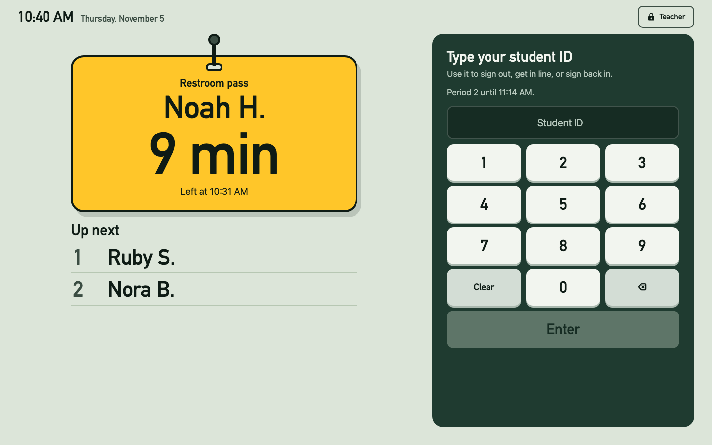

# Restroom Kiosk

A restroom pass kiosk in one offline web page, for any school's bell schedule. Students type their ID to sign out, get in line, or sign back in. The pass shows who is out and for how long.

(All names above are made up.)

## Set it up on your computer

The kiosk is one web page. Once it's downloaded, it needs no install, no sign-in and no internet. Use **Google Chrome**.

### 1. Download it

On this page, click the green **Code** button, then **Download ZIP**.

### 2. Unzip it and put the folder somewhere permanent

Always open the kiosk from the same place. Don't open it from inside the ZIP: Windows treats that as a temporary copy and can delete it.

- **Windows:** In Downloads, right-click the ZIP, choose **Extract All**, and extract it to **Documents**.
- **Mac:** Double-click the ZIP in Downloads, then drag the folder it makes into **Documents**.
- **Chromebook:** In the **Files** app, double-click the ZIP to open it. Copy the folder inside it to **My files**, not Google Drive.

### 3. Open it in Chrome

Open the folder and double-click `Restroom_Kiosk.html`. If it opens in another browser, right-click it and choose **Open with**, then **Google Chrome**.

- Use a regular Chrome window, not Incognito. Incognito forgets everything when you close it.
- Bookmark the page (**Ctrl+D**, or **Cmd+D** on a Mac) so you always open the same file.
- Click **Start setup** and follow the steps, or follow `teacher-guide.docx` or `setup-video.mp4`. It takes about 10 minutes.

### 4. Make it a kiosk

- **Full screen:** **F11** on Windows. **Ctrl+Cmd+F** on a Mac. The full-screen key on a Chromebook (top row, a box with corners). Press it again to leave.
- **Keep the screen on during class:**
  - Windows: **Settings > System > Power** (or **Power & battery**) **> Screen and sleep**. Set "when plugged in" to **Never**.
  - Mac: **System Settings > Lock Screen**. Set "Turn display off on power adapter when inactive" to **Never**.
  - Chromebook: **Settings > Device > Power**. Set "While charging" to **Keep display on**.
  - Keep it plugged in. If your district locks these settings, ask IT to turn off sleep for this computer.
- Put it where students can reach the keypad and you can see the screen. Print `student-guide.pdf` and post it beside the kiosk.

### Keep a backup

Clearing Chrome's browsing data ("Cookies and other site data") erases the kiosk. Once a week, open Teacher view, go to **Backup & export**, and click **Download backup**. Keep the file on your own drive, not a shared one. On a new computer, set up the kiosk the same way, then use **Restore from backup**.

## What's in the repo

| File | What it is |
|---|---|
| `Restroom_Kiosk.html` | The kiosk |
| `teacher-guide.docx` | Teacher guide: setup, step by step, and everyday use (Word) |
| `setup-video.mp4` | Teacher setup video, about 3½ minutes |
| `student-guide.pdf` | One-page student guide, to print and post by the kiosk |
| `student-video.mp4` | Student video, about 1 minute |
| `tests/kiosk_test.py` | Checks student ID import and that Settings save on Lock and on a tab switch: `python3 tests/kiosk_test.py` (needs Chrome) |

## Bell schedule

Nothing is built in. In Teacher view, open **Schedule**, then **Edit the times for a weekday or a date**. Type one day's periods and start and end times, or upload a CSV with Period, Start and End columns. Click **Save schedule**. Then click **Copy and save** with **Monday to Friday** selected. Any day that's different, such as an early-release Wednesday, or a single date like a testing day, can be edited on its own.

## Student IDs

Students type their ID on a number keypad, so IDs are numbers, up to 10 digits.

- If your IDs have one or two letters, like `201234X567` (Los Angeles) or `S12345678` (a Texas S-number), the import drops the letters. Students type only the digits: `201234567`.
- If two students' IDs match once the letters are dropped, both are skipped, and the import tells you which rows.
- IDs longer than 10 digits, like Florida's `FL` state number, are skipped. Export your district's local student number instead.

## Student data

Sign-out logs are stored in the browser on that computer. Backups and exports contain student names and IDs: keep them off shared drives and never commit them. `.gitignore` blocks `.json`, `.csv` and Excel files.

## License

MIT. See [LICENSE](LICENSE).
